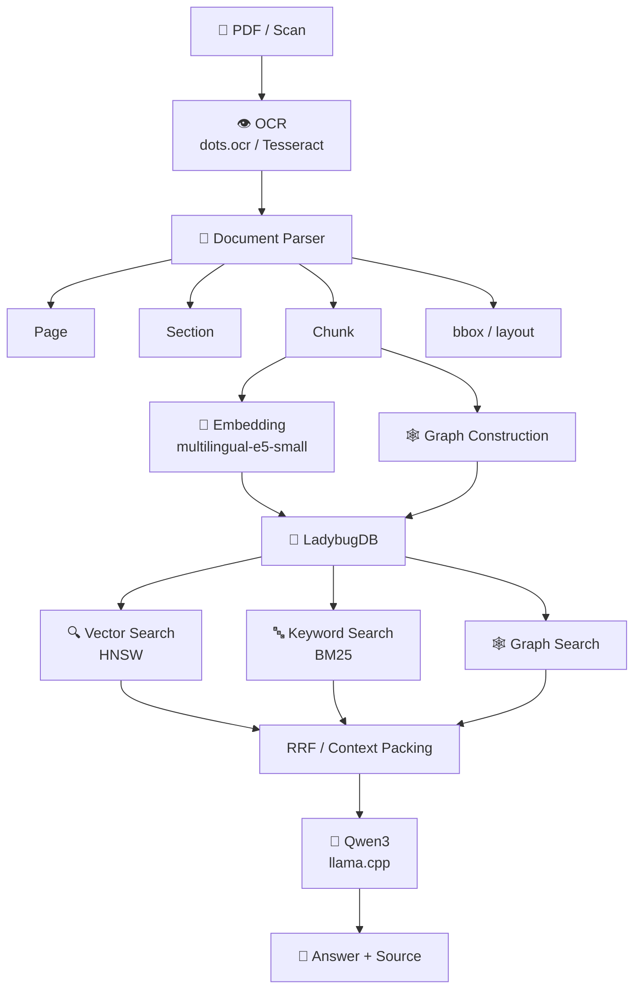
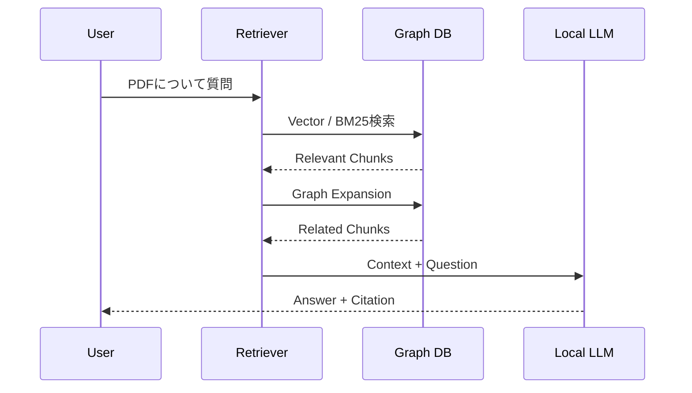
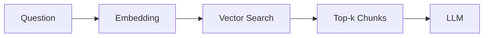
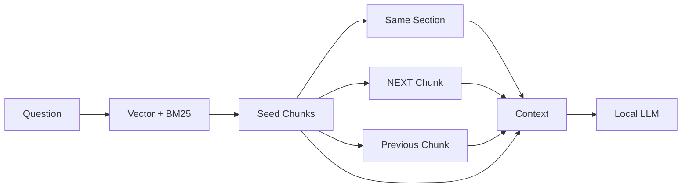
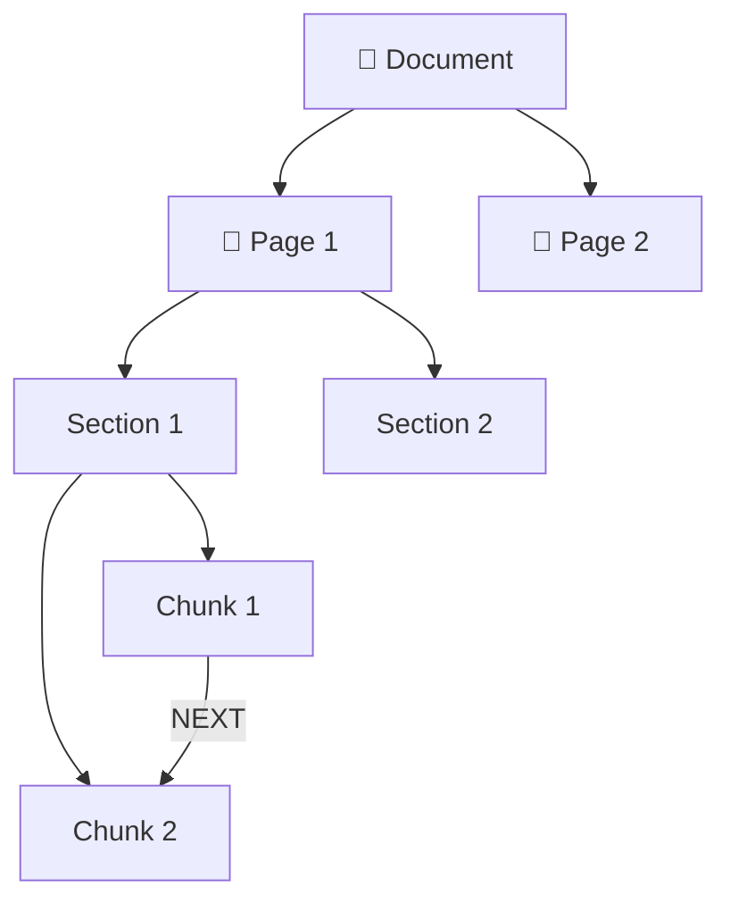
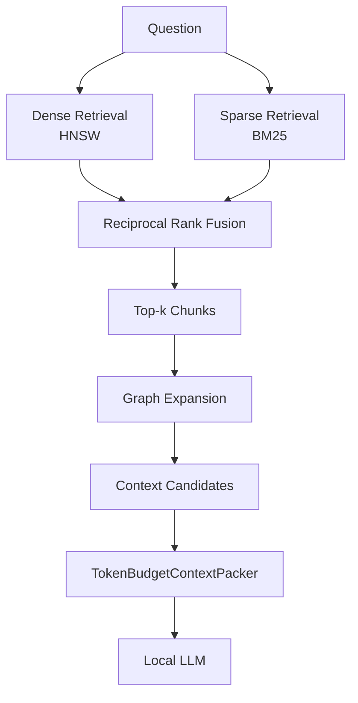
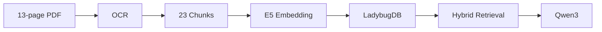
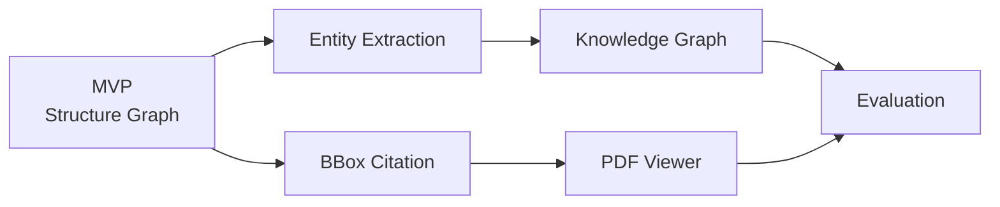

<div align="center">

# Local GraphRAG

### PDF・スキャン文書を、外部APIへ送信せずに検索・質問応答


<br>


</div>

---

## 概要

**Local GraphRAG** は、PDF・スキャン文書に対して

**OCR → 文書構造解析 → 検索 → Local LLMによる回答生成**

までをローカル環境で実行する文書検索システムです。

OpenAI APIなどの外部AI APIを使用せず、Apple Silicon搭載Mac上で一連の処理を完結させることを目的として開発しています。

### 想定用途

- 社内マニュアル・仕様書の検索
- PDFを対象とした質問応答
- スキャン文書のOCR・構造化
- 機密文書向けRAG
- ローカルLLMを利用した文書検索
- API利用料を抑えたAIシステム
- PythonによるPDF・文書処理の自動化

---

## できること

<table>
<tr>
<td width="50%">

### 📄 文書処理

- PDF入力
- OCR
- ページ情報保持
- Section / Chunk管理
- Layout情報保持
- Bounding Box保持

</td>
<td width="50%">

### 🔍 Hybrid Retrieval

- Embedding検索
- BM25検索
- Reciprocal Rank Fusion
- Graph Traversal
- 前後Chunk探索
- 同一Section探索

</td>
</tr>

<tr>
<td width="50%">

### 🤖 Local AI

- Qwen3
- llama.cpp
- GGUF量子化モデル
- 外部LLM API不要
- Apple Silicon対応

</td>
<td width="50%">

### 🔐 Privacy

- PDFを外部送信しない
- 質問内容を外部送信しない
- Embedded Database
- Server不要
- Offline inference

</td>
</tr>
</table>

---

# システム構成



---

# 利用イメージ

例えば、数十ページのPDFマニュアルに対して質問するとします。

### 入力

```text
manual.pdf
```

### 質問

> 装置を停止するときに最初に行う操作は何ですか？

### Retrieval

```text
Vector Search
      +
BM25 Search
      +
Graph Expansion
```

検索されたChunkだけでなく、

- 同じSection
- 前後のChunk
- 文書構造上関連するChunk

もContext候補として利用します。

### 出力イメージ

> 装置を停止する際は、最初にメインスイッチをOFFにします。

```text
出典
manual.pdf
Page 12
Section 3.2
Chunk 41
```

将来的には保存したbboxを利用して、**PDF上の根拠箇所を直接ハイライト表示**できる構成を想定しています。

---

# Demo

> 実行画面のGIFを追加予定

```markdown

```

最終的には以下の流れを1本のGIFで示す予定です。



---

# 通常のVector RAGとの違い

一般的なVector RAGでは、質問にEmbeddingが近いChunkを取得します。



Local GraphRAGでは、Vector検索結果を起点として文書構造も利用します。



### 狙い

Embedding類似度だけでは取得できない、

> 「意味的には少し離れているが、文書構造上は回答に必要な文章」

もContextへ含めることです。

---

# 完全ローカル動作

推論時に以下の外部サービスを使用しません。

```text
❌ OpenAI API
❌ Gemini API
❌ Anthropic API
❌ Cloud OCR API
❌ External Embedding API
❌ Cloud Vector DB
❌ Neo4j Server
```

利用するモデルやライブラリを事前に取得すれば、

```text
OCR
Indexing
Retrieval
Generation
```

をローカル環境で実行できます。

---

# Technology Stack

| 項目 | 使用技術 |
|---|---|
| Language | Python 3.11+ |
| OCR | dots.ocr / Tesseract |
| Embedding | multilingual-e5-small |
| Dense Retrieval | HNSW |
| Sparse Retrieval | BM25 |
| Fusion | Reciprocal Rank Fusion |
| Graph DB | LadybugDB |
| Generator | Qwen3-1.7B |
| Runtime | llama.cpp |
| Test | pytest |
| Lint | Ruff |
| Type Check | mypy |

---

# Document Graph

文書を単純な文字列として保存するのではなく、構造をGraphとして保持します。



現在のMVPでは主に、

```text
Document
Page
Section
Chunk
```

をNodeとして扱います。

主なEdgeは、

```text
HAS_PAGE
HAS_SECTION
HAS_CHUNK
NEXT
```

です。

---

# OCRデータの保持

OCR結果は単純なテキストへ変換するだけではなく、以下の情報を保持できるDomain Modelへ正規化します。

```python
Chunk(
    text="...",
    document_id="manual",
    page=12,
    section_id="section_3_2",
    bbox=[120, 240, 820, 410],
    layout_type="Text",
)
```

この構造により、

```text
回答
 ↓
Chunk
 ↓
Page
 ↓
bbox
 ↓
元PDF上の位置
```

を追跡できる設計にしています。

---

# Retrieval Pipeline

検索は3系統を利用します。



---

# 小規模LLM向けContext制御

Apple Silicon 8GBクラスでは、取得したChunkを大量にLLMへ入力すると、

- Context Windowの圧迫
- Unified Memory使用量増加
- 出力Token数低下
- Generationの早期終了

が発生する場合があります。

そのため、

```text
TokenBudgetContextPacker
```

を実装し、Context量を制御しています。

---

## Context Sweep

Qwen3-1.7Bについて、検索Chunk数を変化させて生成挙動を確認しました。

| Chunks | Prompt tokens* | Generated tokens | Result |
|---:|---:|---:|---|
| 1 | 1146 | 288 | ✅ |
| 2 | 2170 | 205 | ✅ |
| 3 | 3225 | 12 | ⚠️ Early stop |
| 4 | 3574 | 37 | ⚠️ Early stop |

\* tokenizer非使用時の推定値を含みます。

この結果を踏まえ、リソース制約環境ではContextを無制限に追加せず、Whole-chunk単位で制御しています。

---

# 動作確認済みPipeline

実PDFを使用して、



までの一連の処理を確認しています。

---

# Setup

## Requirements

- macOS
- Python 3.11+
- Apple Silicon推奨
- conda
- llama.cpp

環境を作成します。

```bash
conda create \
  -n local-graphrag \
  -c conda-forge \
  -y \
  python=3.11 \
  numpy=1.26
```

Packageをインストールします。

```bash
conda run -n local-graphrag \
  python -m pip install -e ".[embedding,graph,dev]"
```

llama.cppをインストールします。

```bash
brew install llama.cpp
```

---

# Retrieval Demo

LLMやOCRモデルをダウンロードせずに、

- Chunking
- LadybugDB
- HNSW
- BM25
- RRF
- Graph Expansion

を確認できます。

```bash
PYTHONPATH=src:scripts \
conda run -n local-graphrag \
python scripts/run_retrieval_fixture.py
```

---

# Real PDF Experiment

実PDF・Embedding・Local LLMを使用したPipelineです。

```bash
PYTHONPATH=src:scripts \
conda run -n local-graphrag \
python scripts/run_real_models_experiment.py \
  --output-dir data/experiments/real-models-packed2
```

出力例:

```text
real_models_report.json
dots_ocr_page1.txt
generator_raw_stdout.txt
generator_raw_stderr.txt
```

---

# Quality

コード品質について以下を確認しています。

```bash
pytest
ruff
mypy
compileall
```

現在の確認結果:

```text
✅ 23 tests passed
✅ ruff passed
✅ mypy passed
✅ compileall passed
```

---

# Repository Structure

```text
local_graph_rag/

├── configs/
│   └── Edge / Chunk settings
│
├── scripts/
│   ├── Retrieval experiments
│   ├── OCR experiments
│   └── Benchmark runners
│
├── src/local_graphrag/
│   ├── Domain
│   ├── Adapters
│   ├── Services
│   └── Pipelines
│
├── tests/
│   ├── Unit tests
│   └── Integration tests
│
├── data/
│   ├── raw/
│   └── experiments/
│
└── README.md
```

---

# 現在の制約

本リポジトリは **MVP / Research Prototype** です。

現在、以下には制約があります。

- dots.ocrの詳細なbbox / layout parsingは未実装
- 全ページでのdots.ocr実行は未実装
- Full PDF実験ではTesseractを併用
- 日本語OCR誤認識の影響
- Entity抽出は未実装
- Entity間Relationは未実装
- PDF Viewerは未実装
- bbox Highlight UIは未実装
- 回答品質の定量評価は今後実施予定

実装済み部分と今後の開発予定を区別して記載しています。

---

# 今後の予定



### Phase 2

- Entity extraction
- Entity-based Retrieval
- 2-hop Graph Traversal
- Graph Reranking
- bbox Highlight
- PDF Viewer
- Retrieval評価
- Answer Faithfulness評価

---

# 想定できる開発案件

本プロジェクトで扱っている技術は、例えば以下のような開発へ応用できます。

### OCR / Document AI

- PDF OCR
- 帳票読み取り
- 文書構造化
- PDFからCSV / JSONへの変換
- OCR後処理

### RAG / 生成AI

- 社内文書検索
- FAQシステム
- PDF質問応答
- RAG構築
- Hybrid Search
- Local RAG

### Python自動化

- PDF一括処理
- 文書分類
- データ抽出
- CSV生成
- AIモデルを組み込んだ業務自動化

### Local AI

- 外部APIを利用できない環境でのAI導入
- 機密情報を扱う文書検索
- Apple Silicon上でのLLM推論
- llama.cppを利用した軽量AIシステム

---

# Project Goal

このプロジェクトで重視しているのは、単にRAGを動作させることではありません。

> **リソースの限られたローカル環境で、OCR・検索・Graph・LLMを一つのシステムとして成立させること**

を目的としています。

```text
Document AI
     +
Information Retrieval
     +
Graph Database
     +
Local LLM
     +
Edge Computing
```

これらを組み合わせ、外部APIに依存しない文書AIシステムを構築しています。

---

## License / Notes

使用するOCRモデル、Embeddingモデル、LLM、Runtimeについては、それぞれのライセンスを確認してください。

特に商用利用・再配布を行う場合は、各モデルのライセンス条件を個別に確認する必要があります。
